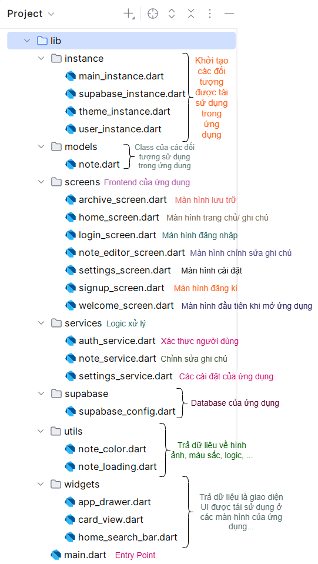

# Phần 1. Overview

Trong ứng dụng có 3 phần xử lý logic chính, tương ứng với `auth_service`, `note_service`, `settings_service`:

- **Authentication**: Xác thực tài khoản
- **Note**: Xử lý CRUD (Create, Read, Update, Delete)
- **Setting**: Xử lý theme, color của ứng dụng

Ngoài ra, trong ứng dụng còn có các phân trang: **Ghi chú**, **Lưu trữ**, **Cài đặt** và các logic xử lý (Đã được nêu trong Phase 2).

**Ý tưởng logic xử lý dùng trong ứng dụng:**

1. Dùng `user_id` để kiểm tra xem ghi chú của người dùng nào
2. **Tính năng search**: Duyệt các title, nếu tồn tại kí tự mà người dùng nhập thì hiện ra ngoài màn hình
3. Sử dụng `shared_preferences` để lưu các cài đặt về theme, color, chế độ sort ghi chú của ứng dụng

---

# Phần 2. Details

### 1. Authentication
Gồm 2 phần xử lý giao diện của login và signup, 1 phần backend xử lý logic `auth_service`.

- ***Login screen [`login_screen.dart`](lib/screens/login_screen.dart)***: Xử lí giao diện, gọi các methods tĩnh từ service
  1. `_handleLogin`: Gọi `AuthService.signIn`
  2. `_navigateToSignUp`: Chuyển qua trang signUp và nhận kết quả trả về
  3. Xử lý giao diện trong hàm `build`:
     - **Header**: Center + chiều ngang màn hình * 0.8
     - **Body**:
       - Tiêu đề đăng nhập
       - Form đăng nhập: Email (Kiểm tra tính chính xác của nhập liệu email) + Password + Error Message + Login Button
       - Phần đăng kí tài khoản => `_navigateToSignUp`
     - **Footer**: Nhóm 2 - Probation Mobile Gen 6

- ***Signup screen [`signup_screen.dart`](lib/screens/signup_screen.dart)***: Xử lí giao diện, gọi các methods tĩnh từ service.  
  > *Lưu ý: Signup screen được push lên bởi Login screen, do vậy không cần có hàm để chuyển qua login.*

  1. `_handleSignup`: Gọi `AuthService.signUp`, trả về thông tin đăng kí cho người dùng (hợp lệ/ không hợp lệ), trả về status cho `login_screen`
  2. Xử lý giao diện trong hàm `build`:
     - **Header**: Appbar (Tạo tài khoản)
     - **Body**:
       - Tiêu đề đăng kí
       - Form đăng kí: username, email, password, confirm password, error message, signup button.
       - Quay lại nếu đã có tài khoản
     - **Footer**: Nhóm 2 - Probation Mobile Gen 6

- ***AuthService [`auth_service.dart`](lib/services/auth_service.dart)***: Gồm các methods tĩnh (Đăng kí, đăng nhập, đăng xuất, lấy user ID)
  1. `signUp`: Đăng kí tài khoản và nhận `response.user` trả về để kiểm tra xem tài khoản này đã được đăng kí trước đó chưa
  2. `signIn`: Đăng nhập và nhận `response.session` trả về để kiểm tra xem tài khoản này đã xác thực email chưa
  3. `currentUserId`: getter tĩnh để nhận ID của người dùng
  4. `signOut`: Xóa session hiện tại, đăng xuất khỏi ứng dụng

---

### 2. App and navigation
Gồm 1 Entry Point và 4 screen.

1. ***Entry Point [`main.dart`](lib/main.dart)***: Khởi tạo supabase, theme và dẫn tới màn hình ban đầu là welcome screen
2. ***Screen Routing***: Là màn hình hiển thị các context, feature, nhận kết quả trả về từ service.
   - ***[`welcome_screen.dart`](lib/screens/welcome_screen.dart)***:
     - Hiển thị logo của ứng dụng
     - Kiểm tra xem đã đăng nhập chưa. Nếu đăng nhập rồi chuyển vào `HomeScreen`. Nếu chưa chuyển vào `LoginScreen`
   - ***[`home_screen.dart`](lib/screens/home_screen.dart), [`archive_screen.dart`](lib/screens/archive_screen.dart)***:
     - Lấy dữ liệu ghi chú thông qua hàm `_fetchNotes()` -> `NoteService.getHomeNotes()`
     - Lấy dữ liệu về chế độ sắp xếp ghi chú thông qua `_loadSortMode()` thông qua `SettingsService` (Sẽ được lưu `shared_preferences`)
     - Hiển thị và có thể trả về kết quả của widget `home_search_bar` (nếu ở `home_screen`) và của `NoteService`, `SettingService`
     - Chuyển qua `note_editor` để CRUD
   - ***[`settings_screen.dart`](lib/screens/settings_screen.dart)***:
     - Hiển thị các lựa chọn về theme, color -> update trong `ThemeInstance` (instance để các screen khác gọi đến) -> Lưu lựa chọn trong `SettingsService`

---

### 3. Notes

1. **[`models/note.dart`](lib/models/note.dart)**: Định nghĩa các attributes của một notes, constructor, parse data từ supabase thành note object, chuyển note object thành map
2. **[`note_editor_screen.dart`](lib/screens/note_editor_screen.dart)**:
   - Hiển thị màn hình để chỉnh sửa ghi chú, các button để người dùng lựa chọn
   - Gọi các methods của `note_service`

---

### 4. Services

1. **[`auth_service.dart`](lib/services/auth_service.dart)**: Xem ở Phần 2. 1. Authentication
2. **[`note_service.dart`](lib/services/note_service.dart)**: 
   - Kiểm tra session đăng nhập (`_requireUserId`, `_checkOwnedNote`)
   - Lấy các ghi chú (`getHomeNotes`, `getArchiveNotes`, `_fetchNoteFromTable`) và sắp xếp ghi chú (`sortNotes`)
   - Lưu ghi chú (`saveNote`)
   - Chuyển ghi chú vào phần lưu trữ và ngược lại (`archiveNote` và `unarchiveNote`)
   - Xóa ghi chú (`deleteNote`)
3. **[`settings_service.dart`](lib/services/settings_service.dart)**:
   - Lưu theme, color, sortmode bằng `shared_preferences`
   - Các hàm `getTheme`, `getColor` và `getSortMode`
